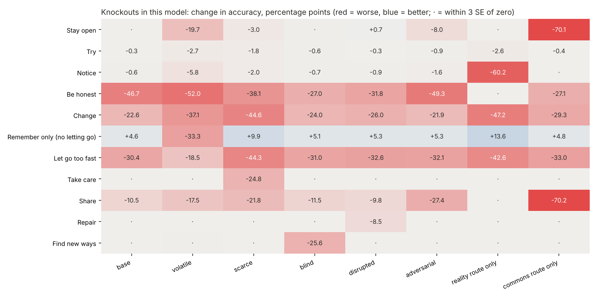

# Results: can a task tell the ten verbs apart?

Produced by [`run.py`](../run.py), seeded, about 30 minutes on two cores. All numbers below are taken from [tables.md](tables.md), which `run.py` writes. Figures are in [../figures/](../figures/).

**What this is.** A check of one model, written by the assistant, in which each verb is a parameter. It asks: if learners worked exactly like this model, which verbs could an experimenter recover from what they record? It does **not** test whether real learners have ten functions. Where the model's structure decides a result, this file says so in the same sentence.

## Set-up in one paragraph

Five learners try to find which of four world states is true over 60 rounds. They choose tests, see binary outcomes, pass outcomes on, receive outcomes from others, and report their beliefs each round. The ten verbs are ten parameters (see the docstring of [`model.py`](../model.py)). Seven conditions: base, volatile (the true state switches), scarce (budget of 20 tests for 60 rounds), blind (standard tests cannot tell two states apart; a new method can), disrupted (links break), adversarial (one sender reports from a wrong state), and all of these at once. Two ways of recording beliefs: **rich** (the full belief vector, with noise) and **sparse** (only a choice of the most likely state each round). For each cell, 100 agents with settings drawn at random were simulated and fitted back by maximum likelihood.

## E1. Recovery

Correlation between true and recovered settings, 100 agents per cell.

1. **With rich belief reports, most verbs come back well.**
   - Change (0.95 to 0.98), Remember / let go (0.93 to 0.99), Share (0.90 to 0.98), Stay open (0.81 to 0.98) and Notice (0.81 to 0.92) are recovered in every condition.
   - Try is moderate (0.68 to 0.81).
   - These figures hold for this model and this task; a different model of the same verbs could do worse.
2. **Two verbs are invisible outside their condition.**
   - Take care is recovered only where the budget is scarce (0.95 scarce, 0.96 all hard).
   - Repair is recovered only where links break (0.94 disrupted, 0.94 all hard).
   - Elsewhere the data contain **no information at all** about them, not just less. This follows directly from the model: an agent that never runs short never shows how it paces, and one whose links never break never repairs.
3. **Two verbs are poorly recovered with this design, for reasons of measurement.**
   - **Be honest** (0.32 to 0.73). A dishonest report in this model passes on what the agent expected, so it is visible only when the expectation and the observation differ. It is worst in the scarce conditions (0.32 scarce, 0.42 all hard), where there are fewer tests and so fewer reports.
   - **Find new ways** (0.12 to 0.50). Each agent acquires the method once, so there is one event per agent to estimate from.
   - A task can fix both: plant observations that contradict what the agent expects, and offer repeated chances to acquire methods.
4. **With sparse choices, the belief verbs blur.**
   - In the base condition: Stay open 0.37, Notice 0.37, Change 0.54, Remember / let go 0.64.
   - Stay open falls to 0.09 in the blind condition.
   - Share, Repair, Take care and Find new ways are unaffected, because their channels do not pass through belief reports.
   - Sparse recovery is better in changing environments (volatile: Stay open 0.86, Notice 0.71; all hard: 0.81 and 0.79), presumably because switching states make choices change more often. That explanation was not tested.

## E2. Trade-offs between verbs

Pooled over 700 agents per regime, no recovered verb tracks the true setting of another verb:
- **Rich:** every off-diagonal correlation is between −0.06 and 0.09.
- **Sparse:** between −0.12 and 0.14.

So in this model, poor recovery is noise, not confusion between verbs.

The review of v0.4 expected Notice and Change to trade off ("a slow learning rate and a weak noticing can look the same"). **That did not happen here** (rich: −0.01 and −0.02). The likely reason is a choice made in writing the model: Notice was written as a threshold on surprise, and Change as an update size. A model that wrote both as update sizes would make them inseparable. So the absence of a trade-off is a property of the model, not evidence about learners.

## E3. Can the full model be told from a simpler one?

Data generated by the full model, by a model without Notice (notice fixed at 1) and by a model without Stay open (stay open fixed at 1), 40 agents each, base condition. Each fitted with all three. Which model BIC picks:

| Generated by | Regime | Picked full | Picked no-Notice | Picked no-Stay-open |
|---|---|---|---|---|
| full | rich | 22 | 10 | 8 |
| full | sparse | **0** | 17 | 23 |
| no-Notice | rich | 2 | 35 | 3 |
| no-Notice | sparse | 1 | 30 | 9 |
| no-Stay-open | rich | 1 | 4 | 35 |
| no-Stay-open | sparse | 1 | 7 | 32 |

**This is the result that matters most for v0.4.** Its distinctive prediction is that "a ten-component causal model will explain intervention effects … better than specified simpler alternatives". In this model, with sparse choices, BIC **never** picked the full model when the full model was true (0 of 40). Even with rich reports it picked it 22 times of 40. Part of that is fair: some generated agents had Notice or Stay open close to 1, where the simpler model really is as good.

So v0.4's main test could fail because of what is measured, without saying anything about learners. An experiment needs belief reports at least as rich as probability judgements every round, or the comparison is decided before it starts.

**Limit:** the simpler models here differ by one verb. The three alternatives the review proposed (one general factor; a standard learner with a weight on social information; three tiers) are not yet fitted.

## E4. Knockouts in this model

**An architecture check only.** All learners in a group had one verb impaired. Accuracy is the mean belief in the true state, rounds 20 to 59, over 400 groups per cell; changes are in percentage points.

1. **Route-specific verbs separate by route, but that was built in.**
   - When agent 0 has only the reality route: Notice −60.2, Stay open 0.0, Share 0.0.
   - When it has only the commons route: Stay open −70.1, Share −70.2, Notice 0.0.
   - That is what v0.4 predicts for R and C. It is true here because the assistant wrote Notice to act on own observations only and Stay open on testimony only. **It is not evidence.**
2. **Condition-specific verbs separate by condition, also by construction.**
   - Take care: −24.8 only when scarce.
   - Repair: −8.5 only when disrupted.
   - Find new ways: −25.6 only in the blind condition.
   - These are v0.4's P3 and P4 and the review's point that some verbs separate by condition. They hold here by how the conditions were defined.
3. **Change, Be honest and letting go too fast hurt everywhere.**
   - Change: −21.9 to −47.2.
   - Be honest: −27.0 to −52.0, except where agent 0 receives nothing.
   - Let go too fast: −18.5 to −44.3.
   - These rows do not discriminate between conditions, as the review expected of "uniform" rows.
4. **The direction of a retention impairment depends on the environment.**
   - Remembering everything (no letting go) *improves* accuracy in stable conditions (+4.6 base, +13.6 reality route only).
   - It costs −33.3 when the world changes.
   - This is v0.4's P5 in this model.
5. **Closing off disagreeing testimony did not protect against the misleader here.**
   - Impairing Stay open cost −8.0 in the adversarial condition, where v0.4 left the sign open (±).
   - This holds only for the setting tried: one misleader against five honest learners. With more misleaders the sign may change. That was not tested.
6. **Try mattered little** (−0.3 in base, −2.7 at most), because the three standard tests are all fairly informative. The size of Try's effect is a property of how unequal the tests are.

## How much this says

- It says which verbs **this task and these measurements** can separate, **for learners built like this model**. A different model of the same ten verbs could give different answers. That is the most important limit.
- Reasoning-mediated checking (the L column of v0.4) is not modelled.
- Several choices decide results and are the assistant's:
  - Notice acts only on own observations, Stay open only on testimony;
  - a dishonest report is the expected outcome;
  - one Change parameter governs both own and received evidence;
  - the misleader is one agent with a fixed wrong state.
- The model is fitted with the same model that generated the data. Fitting a model back to its own simulated data is a common check in computational modelling (named from general knowledge, not checked against a source). It is a necessary check, not a sufficient one.
- Nothing here has been read by anyone outside this conversation.

## What would be worth doing next

1. **A third view:** have the ten verbs written as mechanisms by someone else (another model family, or a modeller), and rerun the recovery. If the results depend mainly on who wrote the model, that is itself the finding.
2. **Fit the three simpler alternatives** from the review, and repeat E3 across conditions.
3. **Fix the task where recovery is weak:** planted surprising observations for Be honest, repeated method opportunities for Find new ways.
4. **Only then:** agents not built around the verbs (language-model agents, then people), with rich belief reports.
