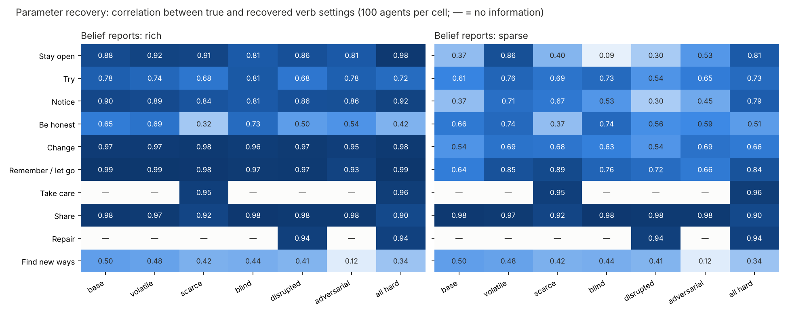
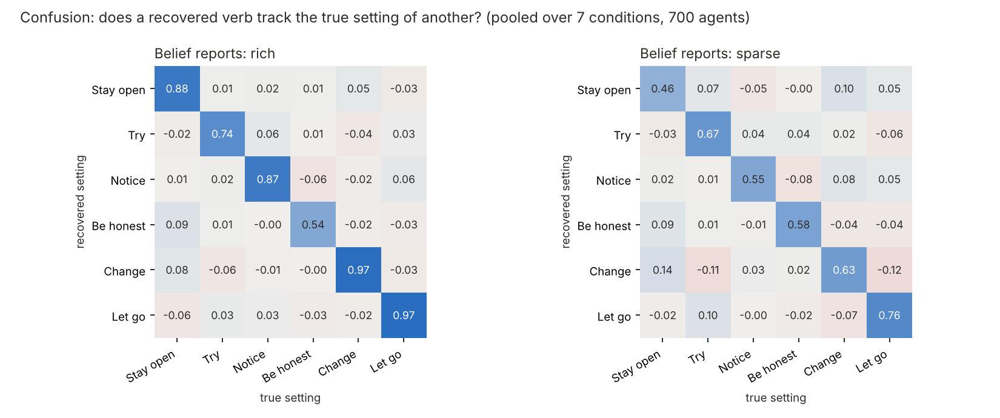
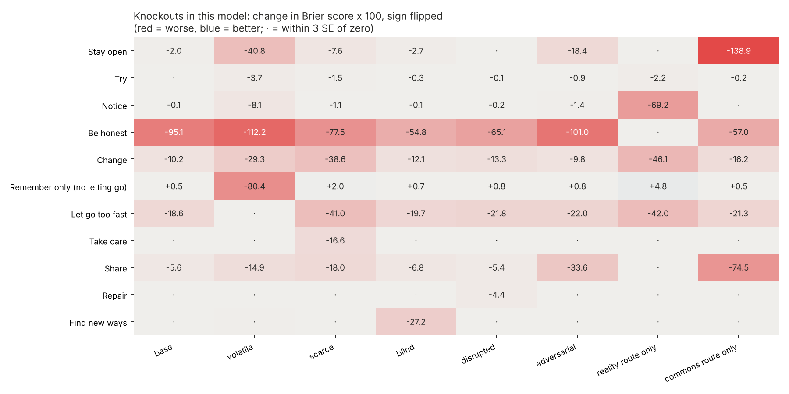

# Results: can a task tell the ten verbs apart?

Produced by [`run.py`](../run.py) and [`tradeoffs.py`](../tradeoffs.py), seeded, about 45 minutes on two cores. All numbers below are taken from [tables.md](tables.md) and [tradeoffs.md](tradeoffs.md), which those scripts write. Figures are in [../figures/](../figures/).

**What this is.** A check of one model, written by the assistant, in which each verb is a parameter. It asks: if learners worked exactly like this model, which verbs could an experimenter recover from what they record? It does **not** test whether real learners have ten functions. Where the model's structure decides a result, this file says so in the same sentence.

## Set-up in one paragraph

Five learners try to find which of four world states is true over 60 rounds. They choose tests, see binary outcomes, pass outcomes on, receive outcomes from others, and report their beliefs each round. The ten verbs are ten parameters (see the docstring of [`model.py`](../model.py)). Seven conditions: base, volatile (the true state switches), scarce (budget of 20 tests for 60 rounds), blind (standard tests cannot tell two states apart; a new method can), disrupted (links break), adversarial (one sender reports from a wrong state), and all of these at once. Two ways of recording beliefs: **rich** (the full belief vector, with noise) and **sparse** (only a choice of the most likely state each round). For each cell, 100 agents with settings drawn at random were simulated and fitted back by maximum likelihood.

## E1. Recovery

Correlation between true and recovered settings, 100 agents per cell.

1. **With rich belief reports, most verbs come back well.**
   - Change (0.95 to 0.98), Remember / let go (0.93 to 0.99), Share (0.90 to 0.98), Stay open (0.81 to 0.98) and Notice (0.81 to 0.92) are recovered in every condition.
   - Try is moderate (0.68 to 0.81).
   - These figures hold for this model and this task; a different model of the same verbs could do worse.
2. **Two verbs are invisible outside their condition.**
   - Take care is recovered only where the budget is scarce (0.95 scarce, 0.96 all hard).
   - Repair is recovered only where links break (0.94 disrupted, 0.94 all hard).
   - Elsewhere the data contain **no information at all** about them, not just less. This follows directly from the model: an agent that never runs short never shows how it paces, and one whose links never break never repairs.
3. **Two verbs are poorly recovered with this design, for reasons of measurement.**
   - **Be honest** (0.32 to 0.73). A dishonest report in this model passes on what the agent expected, so it is visible only when the expectation and the observation differ. It is worst in the scarce conditions (0.32 scarce, 0.42 all hard), where there are fewer tests and so fewer reports.
   - **Find new ways** (0.12 to 0.50). Each agent acquires the method once, so there is one event per agent to estimate from.
   - A task can fix both: plant observations that contradict what the agent expects, and offer repeated chances to acquire methods.
4. **With sparse choices, the belief verbs blur.**
   - In the base condition: Stay open 0.37, Notice 0.37, Change 0.54, Remember / let go 0.64.
   - Stay open falls to 0.09 in the blind condition.
   - Share, Repair, Take care and Find new ways are unaffected, because their channels do not pass through belief reports.
   - Sparse recovery is better in changing environments (volatile: Stay open 0.86, Notice 0.71; all hard: 0.81 and 0.79), presumably because switching states make choices change more often. That explanation was not tested.

## E2. Trade-offs between verbs

**Corrected after the outside review.** The first version of this section said that no trade-offs between verbs appeared. That claim was wrong, and the check behind it could not show it.

**Why the first check could not show it.** E2 correlated each recovered verb with the *true* setting of every other verb (figure below). Pooled over 700 agents per regime, those correlations are small: between −0.06 and 0.09 with rich reports, and between −0.12 and 0.14 with sparse choices. But the true settings were drawn independently, so small values there are what one expects. They say little about whether one verb's estimate compensates for another's.

**E2b. Correlation between estimation errors** (recovered minus true, scaled by the range each verb was drawn from; [`tradeoffs.py`](../tradeoffs.py), table in [tradeoffs.md](tradeoffs.md)). If two verbs compensate for each other, their errors move together. They do:

| Pair | Rich | Sparse |
|---|---|---|
| Stay open and Change | **−0.41** | −0.25 |
| Change and Remember / let go | **+0.25** | +0.14 |
| Stay open and Remember / let go | 0.00 | −0.22 |
| Try and Remember / let go | −0.05 | −0.24 |
| Notice and Change | −0.16 | −0.12 |
| Notice and Remember / let go | −0.16 | −0.08 |

The strongest trade-off, Stay open with Change, comes from how the assistant wrote the model. For testimony that disagrees with the agent's current best guess, the update size is Change × Stay open, so a lower Change can be partly made up by a higher Stay open.

**E2c. Profile likelihood for Change** (20 agents, base condition). Change was held at its true value times 0.7, 0.85, 1, 1.15 and 1.3, and the other five belief verbs were refitted.
- **Rich reports:** holding Change 30% too low costs on average 11.8 in log-likelihood (median 10.9). Stay open moves up by 0.12 and Notice by 0.13 (median 0.05) to compensate. So the trade-off is real but partial: the data still pin Change down. The profile is much flatter above the best value: +15% costs only 0.7 (median 0.1). Part of that flatness is an artefact, because for agents whose true Change is near 1 the higher values are clipped back to 1.
- **Sparse choices:** the profile is flat (median losses between −0.1 and 0.2), and for some agents a fit with Change held away from its true value had a *higher* likelihood (mean "loss" −3.4 at 0.7 and −4.2 at 1.3).

**A correction to E2c (after a second outside review).** The first version of this note read those negative losses as the optimiser failing. That inference was wrong. E2c measures each restricted fit against the fit with Change held at its **true** value, and the true value need not maximise the likelihood of a finite, noisy dataset. A higher likelihood away from it is possible with a perfect optimiser. The "losses" in E2c are therefore losses against the true value, not against the best fit.

**E2d. The optimiser checked directly** (same 20 agents; table in [tradeoffs.md](tradeoffs.md)). Each agent was fitted without restriction twice: with 3 random starts, as in E1, and with 20. Every restricted fit from E2c was then compared with the best unrestricted fit.

| Regime | 3-start fit short of the best by more than 0.5 | largest shortfall | a restricted fit beat the best unrestricted fit |
|---|---|---|---|
| rich | 2 of 20 agents | 36.6 | 1 of 20 |
| sparse | 3 of 20 agents | 61.4 | 2 of 20 |

So the optimiser does sometimes miss the maximum, in **both** regimes, for a minority of agents, sometimes by a large margin. Even 20 starts were not always enough: a fit with one parameter held fixed beat them for 1 agent (rich) and 2 (sparse). The E1 recovery figures may therefore understate what this design can recover, with rich reports as well as sparse choices. How much was not measured. This is now shown directly, not inferred from the profile.

**What this changes.** The review of v0.4 expected Notice and Change to trade off. With rich reports they do, a little (−0.16), but the larger trade-off is between Stay open and Change, which nobody predicted. Poor recovery is partly noise and partly compensation. Which pairs trade off depends on how the verbs are written as mechanisms, so another model of the same verbs could show different pairs.

## E3. Can the full model be told from a simpler one?

Data generated by the full model, by a model without Notice (notice fixed at 1) and by a model without Stay open (stay open fixed at 1), 40 agents each, base condition. Each fitted with all three. Which model BIC picks:

| Generated by | Regime | Picked full | Picked no-Notice | Picked no-Stay-open |
|---|---|---|---|---|
| full | rich | 22 | 10 | 8 |
| full | sparse | **0** | 17 | 23 |
| no-Notice | rich | 2 | 35 | 3 |
| no-Notice | sparse | 1 | 30 | 9 |
| no-Stay-open | rich | 1 | 4 | 35 |
| no-Stay-open | sparse | 1 | 7 | 32 |

**This is the result that matters most for v0.4.** Its distinctive prediction is that "a ten-component causal model will explain intervention effects … better than specified simpler alternatives". In this model, with sparse choices, BIC **never** picked the full model when the full model was true (0 of 40). Even with rich reports it picked it 22 times of 40. Part of that is fair: some generated agents had Notice or Stay open close to 1, where the simpler model really is as good.

So v0.4's main test could fail because of what is measured, without saying anything about learners. With this task (60 rounds, one choice per round), rich belief reports are what made the full model selectable. That does not mean rich reports are the only remedy. The outside review pointed out that longer tasks, more trials or other kinds of choice might also work; none of these was tried. What follows in general: a model comparison counts as a test only in a design where model recovery has shown it can pick the true model.

**Limit:** the simpler models here differ by one verb. The three alternatives the review proposed (one general factor; a standard learner with a weight on social information; three tiers) are not yet fitted.

## E4. Knockouts in this model

**An architecture check only.** All learners in a group had one verb impaired, over 400 groups per cell, rounds 20 to 59.

**Three measures.** The first version reported only the mean probability given to the true state, and called it "accuracy". The outside review pointed out that it is neither classification accuracy nor a proper scoring rule. It is now called **mean belief in the true state**. Two proper scoring rules are added: the **Brier score** (lower is better) and the **log score** (mean log belief in the true state; higher is better). All three are in [tables.md](tables.md). Mean-belief changes are in percentage points.

1. **Route-specific verbs separate by route, but that was built in.**
   - When agent 0 has only the reality route: Notice −60.2, Stay open 0.0, Share 0.0.
   - When it has only the commons route: Stay open −70.1, Share −70.2, Notice 0.0.
   - That is what v0.4 predicts for R and C. It is true here because the assistant wrote Notice to act on own observations only and Stay open on testimony only. **It is not evidence.**
2. **Condition-specific verbs separate by condition, also by construction.**
   - Take care: −24.8 only when scarce.
   - Repair: −8.5 only when disrupted.
   - Find new ways: −25.6 only in the blind condition.
   - These are v0.4's P3 and P4 and the review's point that some verbs separate by condition. They hold here by how the conditions were defined.
3. **Change and Be honest hurt everywhere, on all three measures.**
   - Change: −21.9 to −47.2 on mean belief.
   - Be honest: −27.0 to −52.0, except where agent 0 receives nothing.
   - These rows do not discriminate between conditions, as the review expected of "uniform" rows.
4. **Letting go too fast: the measure decides how much it costs in a changing world.**
   - On mean belief it costs −18.5 when the world changes.
   - On the Brier score the change is −0.2 × 10⁻² (SE 0.6), not distinguishable from zero; on the log score −0.06.
   - Elsewhere it hurts on all three measures (Brier +18.6 to +42.0, × 10⁻²).
   - So the mean-belief measure exaggerated this harm. The outside review's concern, that a verb's apparent effect could depend on how performance is scored, holds here.
5. **The direction of a retention impairment depends on the environment, but this is largely built into the model.**
   - Remembering everything (no letting go) *improves* all three measures in stable conditions (mean belief +4.6 base, +13.6 reality route only).
   - When the world changes it costs −33.3 on mean belief, +80.4 × 10⁻² on Brier, and −14.66 on the log score: beliefs become confidently wrong.
   - **Why this is not evidence for a Remember / let go function** (pointed out by the second outside review): when the world changes, the learner in this model has no estimate of how often it changes. Mixing beliefs back toward uniform is its only way out of confidence in an old state. So forgetting must help in a changing world and cost in a stable one; the crossover follows from the architecture. A conventional learner that estimates the rate of change (a transition model) could adapt without forgetting at all. Whether Remember / let go explains anything beyond such a learner is untested.
6. **Closing off disagreeing testimony did not protect against the misleader here.**
   - Impairing Stay open cost −8.0 on mean belief, +18.4 × 10⁻² on Brier, in the adversarial condition, where v0.4 left the sign open (±).
   - This holds only for the setting tried: one misleader against five honest learners. With more misleaders the sign may change. That was not tested.
   - Under broken links, the small *gain* from impairing Stay open on mean belief (+0.7, SE 0.1) is not there on Brier (+0.5 × 10⁻², SE 0.2, within 3 SE of zero).
7. **Try mattered little** (−0.3 in base, −2.7 at most on mean belief), because the three standard tests are all fairly informative. The size of Try's effect is a property of how unequal the tests are.

## What the parameters are, and are not

The outside review's deepest point is construct validity: several verbs are modelled far more narrowly than the theory means them. A parameter can be recovered without the thing the theory names having been modelled at all.

| Verb | What it is in this model | What it is not |
|---|---|---|
| Repair | the chance per round of restoring a broken message link | acknowledging harm, addressing errors, restoring trust |
| Be honest | the chance of passing on the observed outcome rather than the expected one | withholding, strategic deception, misleading framing |
| Take care | how evenly a test budget is spent | care for others, for the commons, or for one's own conditions |
| Stay open | the weight on testimony that disagrees with one's best guess | openness in reasoning; considering hypotheses not yet held |
| Find new ways | the chance of acquiring one fixed extra test | inventing, validating or comparing methods |
| Share | the chance of passing on one's own outcome | provenance, context, choosing what to share |

**So the results above concern these narrow mechanisms, under the verbs' names.** They do not show that the verbs as the theory means them can be recovered.

## What the outside review changed

Two outside reviews of this pull request are kept verbatim in [../../sources/REVIEW_OF_PR155.md](../../sources/REVIEW_OF_PR155.md) and [../../sources/REVIEW_OF_PR155_2.md](../../sources/REVIEW_OF_PR155_2.md). The assistant checked each point against the code and the stored results.

| Point | Verdict | What was done |
|---|---|---|
| E2 cannot show the absence of trade-offs | **Right.** The claim was wrong. | E2b (error correlations) and E2c (profile likelihood) added; E2 rewritten. Stay open and Change trade off (−0.41, rich). |
| *Second review:* E2c's baseline is the true value, not the best fit, so it cannot show optimiser failure | **Right.** The inference was wrong. | E2d added: unrestricted fits with 3 and 20 starts. The optimiser does miss the maximum for a few agents, in both regimes. |
| *Second review:* the Remember / let go crossover is built in, because the learner has no transition model | **Right.** | Stated at E4 point 5; not to be read as support for the hypothesis. |
| The replay test checked only the belief in the true state | **Right.** | The simulation now records the full noiseless belief vector, and the test compares every component in every round, in every condition. It passes. No random draws were added, so all earlier results reproduce exactly. |
| "Accuracy" is mean belief in the true state, not a proper score | **Right.** | Renamed; Brier and log scores added to E4; two conclusions changed (points 4 and 6 above). |
| "Experiments must collect rich belief reports" is too strong | **Right.** | Narrowed in E3 to this task; other remedies named as untried. |
| Construct validity of Repair, Be honest, Take care | **Right**, and the most important point. | The table above. |
| M1 to M3 not tested | Already stated; kept. | |
| D50 and D51 sequencing | Already stated in the pull request; kept. | |
| A different, independent model built around the phenomenon | **Agreed as the next step.** | Added below. |

## How much this says

- It says which verbs **this task and these measurements** can separate, **for learners built like this model**. A different model of the same ten verbs could give different answers. That is the most important limit.
- The verbs are modelled narrowly (see the table above).
- Reasoning-mediated checking (the L column of v0.4) is not modelled.
- Several choices decide results and are the assistant's:
  - Notice acts only on own observations, Stay open only on testimony;
  - a dishonest report is the expected outcome;
  - one Change parameter governs both own and received evidence, and multiplies with Stay open for disagreeing testimony (the source of the strongest trade-off);
  - the misleader is one agent with a fixed wrong state.
- The model is fitted with the same model that generated the data. Fitting a model back to its own simulated data is a common check in computational modelling (named from general knowledge, not checked against a source). It is a necessary check, not a sufficient one.
- The optimiser with 3 starts missed the best fit for 2 to 3 agents in 20, in both regimes (E2d), so all recovery figures mix identifiability and optimisation.
- One outside reader has reviewed the code and results without rerunning them. No human reader has assessed any of it.

## What would be worth doing next

1. **An independent model built around the phenomenon** (now the next experiment, with a design brief in [../../briefs/INCOMPATIBLE_ACCOUNTS_BRIEF.md](../../briefs/INCOMPATIBLE_ACCOUNTS_BRIEF.md)), as the outside reviews propose. Two intelligences hold incompatible accounts of events; claims carry timestamps and provenance; memories are fallible; there is an external record, chances to verify independently, and others who can add evidence. Agents are *not* built with ten verb parameters. Three outcomes are kept apart: whether the correct account becomes identifiable, whether each intelligence changes its beliefs, and whether they keep coordinating despite disagreement. Then ask whether the ten verbs describe the resulting behaviour better than fewer categories. Ideally it is designed by someone other than this assistant.
2. **Fit the three simpler alternatives** from the review, and repeat E3 across conditions, with more random starts. Planned in [../PLAN_V2.md](../PLAN_V2.md), started but not run ([../../wip/](../../wip/README.md)).
3. **Fix the task where recovery is weak:** planted surprising observations for Be honest, repeated method opportunities for Find new ways.
4. **Only then:** agents not built around the verbs (language-model agents, then people).
