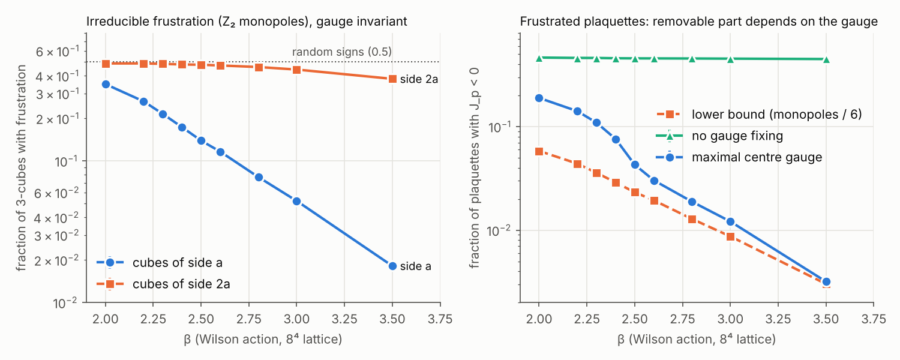

# Note: frustration of the centre (Z₂) sector in 4D SU(2)

*Working note, 7 November 2026. Written by the author with an AI assistant. Not a result. The decomposition below is elementary and checked numerically; the numbers come from a small pilot (8⁴, 20 configurations per β, one seed).*

## Why this question

[`ROUTE.md`](ROUTE.md) found that the twist part of the O(3) proof does not carry over to 4D SU(2), and that Part 2, the sign clusters, is the obstacle wherever no unfrustrated Ising embedding exists ([`CPN_TWIST_THEOREM.md`](CPN_TWIST_THEOREM.md) shows a genuinely frustrated plaquette for the natural CP^{N−1} embedding). This note asks the same question for the gauge theory itself, through its centre.

Both recent proofs of exponential decay in the 2D O(3) model fix the length of one spin component and work with what is left:

- OpenAI (2026), Section 4: the signs of one component form a ferromagnetic Ising system once the absolute values are fixed, and the proof uses positive association of these signs and their bonds (Campbell–Chayes). Since σ·σ' splits into an in-plane part plus |σ^z||σ'^z| s s', the Ising coupling is b_xy |σ_x^z| |σ_y^z| (our one-line derivation).
- Ding, Huang and Yang (arXiv:2611.04908): conditioning gives an XY model with random couplings K_uv = β r_u r_v.

In both, an effective coupling is a **product over both ends** and therefore **never negative**. That is what makes the FKG / random-cluster step work.

[`ROUTE.md`](ROUTE.md) notes that conditioning SU(2) on components does not leave a U(1) gauge theory, because group products mix components. The centre is different: it factors out of every product exactly, so conditioning on the coset does leave a Z₂ gauge theory, without fixing a gauge. That is the decomposition below.

*Heuristic origin, for the record:* this came out of a model of mutual dependence in which a bond grows as α·x₁·x₂ (it exists only if both sides invest) and the bond in turn makes investing cheaper. In O(3) that product structure is literal. The question here is what happens to it in a gauge theory, where the "bond" lives on a loop rather than on an edge.

## The exact decomposition

Write every SU(2) link as U = s·V with s = ±1 and V the representative with Tr V ≥ 0. Haar measure factorises (uniform s, Haar on the half-sphere for V), so for the Wilson action:

1. **Conditional law.** Given all V, the signs s form a Z₂ lattice gauge theory with plaquette couplings

   J_p = (β/2) Tr V_p,  since Tr U_p = s_p Tr V_p, with s_p the product of the four signs round p.

   The *size* |J_p| = (β/2)|Tr U_p| is gauge invariant. Only the *sign* of J_p depends on the gauge and on the choice of representatives.

2. **Irreducible frustration = Z₂ monopoles.** J_p can be negative (frustrated). Round the six faces of any 3-cube c, every link appears twice, so ∏ s_p = 1 and

   ∏_{p∈∂c} sign J_p = ∏_{p∈∂c} sign Tr U_p =: σ_c.

   σ_c is gauge invariant and independent of every choice. A cube with σ_c = −1 carries frustration that no gauge transformation and no choice of representatives can remove. These are the Z₂ monopoles of the mixed-action literature: cubes whose faces carry an odd number of negative plaquettes (Stack †; Datta and Gavai † write σ_c = ∏_{p∈∂c} σ_p). Frustrated plaquettes must form sheets bounded by the monopole loops.

3. **Without monopoles, the Z₂ sector is a ferromagnet in a twist sector.** If σ_c = +1 on every cube, sign J is a closed Z₂ 2-cochain. On the torus T⁴ it is then dη times a representative of a class k ∈ H²(T⁴; Z₂) ≅ Z₂⁶. Substituting s → η·s turns the conditional law into a Z₂ gauge theory with **non-negative** couplings |J_p|, in the topological sector k. Those sectors are 't Hooft's twisted (centre-flux) sectors, whose free energy is the target quantity in [`ROUTE.md`](ROUTE.md) (Tomboulis–Yaffe). *Elementary cohomology; not machine-checked.*

4. **Suppressing monopoles does not disturb the conditional law.** By (2), the constraint σ_c = +1 depends on V only. Imposing it, for example with a chemical potential λ Σ_c (1 − σ_c) as in the mixed-action studies, restricts V and leaves the conditional law of s given V exactly as in (1). The positive-plaquette model is too strong for this purpose: Tr U_p ≥ 0 forces s_p = sign Tr V_p, so the Z₂ sector is frozen given V.

So, in a monopole-free regularisation, the centre sector given V is a ferromagnetic Z₂ gauge theory with random couplings (β/2)|Tr U_p| in a fixed twist sector. That is the gauge analogue of the conditioned Ising / XY systems in the O(3) proofs. With the Wilson action it is not, because of (2).

## Pilot: how much frustration does the Wilson action have?

Code: [`pilot/su2_frustration/`](pilot/su2_frustration/). Heatbath (Kennedy–Pendleton) plus three overrelaxation steps per sweep; 300 thermalisation sweeps from a cold start, then 20 configurations 10 sweeps apart; direct maximal centre gauge (DMCG) by site-wise exact maximisation of Σ (Tr U)², with overrelaxation and then plain polishing. Validation: ⟨½ Tr U_p⟩ = 0.125 at β = 0.5 (strong coupling: β/4), 0.6304 at β = 2.4 and 0.6531 at β = 2.5 (0.6300 and 0.6522 in table I of hep-lat/9704006 †); plaquettes and Wilson loops are unchanged by random gauge transformations and by gauge fixing to 10⁻¹³; the identity in (2) holds configuration by configuration.

| β | ⟨½Tr U_p⟩ | Tr U_p < 0 | σ_c = −1, side a | σ_c = −1, side 2a | largest monopole cluster | mean cluster (links) | J_p < 0, no fixing | J_p < 0, DMCG | lower bound ρ/6 | ½\|Tr U_p\| < 0.1 |
|---|---|---|---|---|---|---|---|---|---|---|
| 2.0 | 0.5008 | 0.108 | 0.349 | 0.488 | 1.00 | 2603 | 0.464 | 0.189 | 0.058 | 0.065 |
| 2.2 | 0.5693 | 0.068 | 0.264 | 0.488 | 0.98 | 254 | 0.461 | 0.141 | 0.044 | 0.050 |
| 2.3 | 0.6027 | 0.051 | 0.215 | 0.485 | 0.94 | 91 | 0.460 | 0.109 | 0.036 | 0.040 |
| 2.4 | 0.6304 | 0.038 | 0.173 | 0.480 | 0.79 | 35.5 | 0.457 | 0.076 | 0.029 | 0.033 |
| 2.5 | 0.6531 | 0.029 | 0.139 | 0.478 | 0.40 | 17.5 | 0.456 | 0.043 | 0.023 | 0.028 |
| 2.6 | 0.6697 | 0.023 | 0.116 | 0.473 | 0.13 | 11.6 | 0.456 | 0.030 | 0.019 | 0.024 |
| 2.8 | 0.6989 | 0.015 | 0.077 | 0.461 | 0.04 | 7.3 | 0.455 | 0.019 | 0.013 | 0.017 |
| 3.0 | 0.7228 | 0.010 | 0.052 | 0.442 | 0.04 | 6.0 | 0.453 | 0.012 | 0.009 | 0.012 |
| 3.5 | 0.7681 | 0.003 | 0.018 | 0.380 | 0.04 | 4.5 | 0.450 | 0.0032 | 0.0030 | 0.005 |

Fractions are per 3-cube (σ_c) or per plaquette (all others). The "side 2a" column uses the signs of 2×2 Wilson loops on the faces of cubes of side 2. Monopole clusters are connected components of the frustrated cubes on the dual lattice. "No fixing" means the links as the Monte Carlo leaves them. Statistical errors are below 1% of the values, except the cluster columns (see the JSON files).

**Findings**

1. **Irreducible frustration is dense at the cutoff.** 17% of 3-cubes at β = 2.4, 14% at β = 2.5. Each plaquette lies on 4 cubes and there are 4 cubes and 6 plaquettes per site, so at least a fraction ρ/6 of plaquettes must be frustrated in *any* representation.
2. **It grows in physical units as a → 0.** With a√σ from Teper's compilation (0.467, 0.3687, 0.2673, 0.186 at β = 2.2, 2.3, 2.4, 2.5), the monopole line density in physical units (length per 4-volume, in units of σ^{3/2}, up to a constant factor 4), ρ/(a√σ)³, is 2.6, 4.3, 9.1 and 21.7. The density falls with β much more slowly than a³. These are ultraviolet objects, as expected for lattice artefacts. For a proof route this matters: with the Wilson action the O(3)-type conditioning at the cutoff meets frustration everywhere.
3. **Coarser is worse.** For cubes of side 2a built from 2×2 loops, the frustrated fraction is 0.47–0.49 for β ≤ 2.6, close to the 0.5 of random signs. Conditioning on a naive coarse centre sign after one blocking step is maximally frustrated. If this route works at all, it works at the cutoff and in a monopole-free action.
4. **Monopole loops percolate at strong coupling and are small at weak coupling** (on 8⁴): the largest cluster holds ≥ 79% of the monopole links for β ≤ 2.4, and 13% or less for β ≥ 2.6. Finite-size effects not studied.
5. **DMCG removes most of the removable frustration.** Without fixing, about 46% of the J_p are negative. In DMCG it is 2.6 times the lower bound at β = 2.4, 1.5 times at 2.8 and practically at the bound at 3.5.
6. **Most couplings are strong.** The 4D Z₂ gauge theory with a uniform coupling is self-dual at J = ½ ln(1 + √2) ≈ 0.44 *(from memory)*. At β = 2.4 that corresponds to ½|Tr U_p| ≈ 0.18, and only a few per cent of plaquettes lie below it (3.3% below 0.1, 9.3% below 0.25). A uniform-coupling intuition would put the conditional Z₂ sector deep in its ordered phase. Whatever disorders it must come from *correlated* weak regions, the analogue of the "defective" regions of Ding–Huang–Yang. This says which mechanism to look for. It is not a result.

**Limits.** One lattice size (8⁴), one seed, 20 configurations per β, Wilson action only. DMCG finds local maxima (the Gribov-copy problem is documented for this gauge); only the representation-dependent columns are affected. At β ≳ 2.5 an 8⁴ lattice is small compared to the confinement scale. Blocking was tested only through 2×2 loops.

## The question this leaves

> In SU(2) lattice gauge theory with Z₂ monopoles suppressed, the centre sector given V is a ferromagnetic Z₂ gauge theory with random couplings (β/2)|Tr U_p| in a twist sector. Is there a crossing or association argument for it, analogous to §4 of the OpenAI O(3) proof or to Ding–Huang–Yang, that gives decay of the right observables? And is the monopole-suppressed action in the same universality class as the Wilson action?

The second half has numerical support (monopole and vortex suppression in mixed actions restores the expected deconfinement behaviour; Datta and Gavai, Datta), but no proof. For the Clay problem any regularisation is allowed, as long as its continuum limit is the right theory.

## Next steps

- [ ] Monopole-suppressed heatbath (constraint σ_c = +1 or a large λ) and repeat the pilot: are the weak couplings then clustered, and how does the twist-sector free energy behave with L?
- [ ] Check whether the positivity statement in (3) is already in the Mack–Petkova, Kovács–Tomboulis or Haymaker papers.
- [ ] Write (1)–(4) in Lean on a finite lattice (the change of variables and the Bianchi identity are finite statements).
- [ ] Ask an expert (E. Seiler; A. van Enter for the statistical-mechanics side).

## Sources

Marked † : seen only in search excerpts (abstract, a table or a few paragraphs), not read in full. The claims taken from them are the ones quoted in those excerpts.

- OpenAI, [Exponential decay in two-dimensional classical O(n) models](https://github.com/openai/math/blob/main/preprints/Exponential-decay-in-two-dimensional-classical-On-models-September-23-2026/paper.pdf) (2026), §4 (read in full).
- Ding, Huang, Yang, [Exponential decay for the two-dimensional Heisenberg model](https://arxiv.org/html/2611.04908), arXiv:2611.04908 (structure read; K_uv = β r_u r_v as in ROUTE.md).
- † Bertle, Faber, Greensite, Olejník (authors from memory), [The structure of projected center vortices in lattice gauge theory](https://ar5iv.arxiv.org/html/hep-lat/9903023) (DMCG and centre projection).
- † Bornyakov et al. (authors from memory), [P-vortices and drama of Gribov copies](https://ar5iv.labs.arxiv.org/html/hep-lat/0009035).
- † Haymaker, [Connections between thin, thick and projection vortices](https://web3.arxiv.org/pdf/hep-lat/0205002) (SO(3) × Z₂ bookkeeping, Kovács–Tomboulis counters).
- † Datta and Gavai, [Impact of Z₂ monopoles and vortices on the deconfinement transition](https://arxiv.org/pdf/hep-lat/9908040); Datta, [hep-lat/9909139](https://arxiv.org/pdf/hep-lat/9909139).
- † Stack, [Confinement by monopoles in the positive plaquette model](https://pdf.arxiv.org/pdf/hep-lat/9601019).
- † [Scaling and confinement aspects of tadpole improved SU(2) lattice gauge theory and its abelian projection](https://arxiv.org/pdf/hep-lat/9704006), arXiv:hep-lat/9704006, table I (plaquette values; authors not checked).
- † Teper (author from memory), [Glueball masses and other physical properties of SU(N) gauge theories](https://arxiv.org/pdf/hep-th/9812187), table 10 (a√σ).
